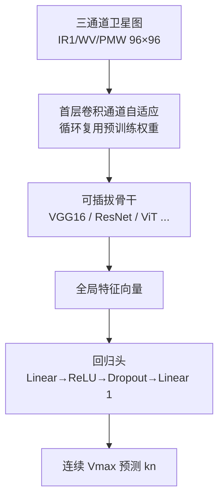

# 基于多通道卫星云图与可插拔骨干的热带气旋强度回归框架：方法、创新与误差分析

> 一份面向 TCIR 基准、以工程可复现性为特色的端到端 Vmax 回归研究完整版论文草稿。
> 所有实验数值均来自本框架在西北太平洋（WPAC）测试集上的实际运行结果。

---

## 摘要

热带气旋（Tropical Cyclone, TC）的强度——以最大持续风速 Vmax（knot，kn）衡量——是预警与防灾减灾的核心物理量。传统 Dvorak 主观定强技术依赖经验、夜间受限、对快速增强不敏感。随着 TCIR 等公开卫星基准的出现，数据驱动的端到端定强成为可能。本文基于 PyTorch 构建了一个**配置驱动、可插拔多通道骨干**的热带气旋强度识别框架，以多通道卫星云图（IR1 / WV / PMW）端到端回归 Vmax。框架以「配置驱动 + 多通道伪 RGB 输入 + 按风暴防泄漏切分 + HDF5 二级紧凑数据管线 + AMP 混合精度训练」为核心，并**针对卫星影像中普遍存在的两类数据缺失（整通道缺失与图像内局部区域缺失），设计了基于物理下界与连通块的空间插值修复管线**，以及**基于损坏度量的过度损坏样本过滤**。在西北太平洋（WPAC，2893 个测试样本）上取得 **RMSE 13.54 kn、MAE 10.29 kn、R² 0.83**，相比未做缺失修正的基线（RMSE 16.22 kn）显著提升，已逼近 best-track 约 10 kn 的标注噪声下限，且数据自带标签、无需人工标注。多组证据一致表明缺失修复有效：分组对比中经插值修复的含缺失样本（637 帧）误差**反而低于**本身干净的样本（2256 帧，RMSE 差 −1.61 kn）；输入级消融（同一批缺失样本分别喂「修复后」与「原始花屏」）显示修复带来 **Δ RMSE = +2.17 kn** 的收益。此外，把回归输出按强度分级阈值离散化后，二分类准确率 **0.895**、三分类 **0.827**、Saffir–Simpson 七分类 **0.574**，而**±1 档准确率高达 0.95–1.00**，说明误差集中于相邻档边界而非跨档错判。本文进一步系统剖析了单帧回归范式的误差结构，发现**极端强度段存在系统性向均值低估**（worst-12 样本的 signed error 全为负值，达 −47 ~ −62 kn），并据此提出分段/分位数回归、时序与多源融合、多洋区域适应、不确定性估计等可行改进路线。本框架适合作为多洋区/多骨干定强研究的**可复现基线平台**。

**关键词**：热带气旋定强；深度学习；卫星遥感；TCIR；VGG16；强度回归；缺失数据插补；数据质量控制；误差分析

---

## 1 引言

### 1.1 研究背景
热带气旋的实时、客观定强长期依赖 Dvorak 技术[1]及其自动化变体（ADT[2]、SATCON[3]）。这些方法以静止卫星红外云图结构（如中心密蔽云盖 CDO、风眼特征）为基础，由 analysts 经验判读，存在主观性强、夜间与边缘洋区受限、对快速增强（Rapid Intensification, RI）与快速减弱（Rapid Weakening, RW）不敏感等固有短板。

### 1.2 数据驱动的机遇
TCIR（Tropical Cyclone for Image-to-intensity Regression）基准[4]公开了 1285 个热带气旋、共 70 501 帧多通道卫星图像（IR1 / WV / VIS / PMW，201×201，0.07° 网格，best-track 标签来自 JTWC / HURDAT2），为公平的强度估计模型评测提供了数据基础。相比传统分类范式（将 Vmax 离散为 5 kn 或更大区间）[4]，端到端**回归**直接输出连续风速，保留量级信息、避免区间边界信息损失，更契合定强这一连续物理量的本质。

### 1.3 现有不足与本文动机
尽管已有旋转混合 CNN[4]、时序聚合网络 TFA-Net[5]、时空 Transformer[6]、多平台融合模型[7] 等工作，但多数研究聚焦单点精度提升，缺少一个**可复现、易扩展、且对误差来源透明**的研究基线。此外，卫星影像普遍存在通道缺测与局部区域缺测，既有工作多以「置零」草率处理，忽略了缺失对定强精度的潜在侵蚀。本文贡献如下：

1. 提出一个**配置驱动、零代码侵入**的可插拔骨干框架，支持 VGG16 / ResNet / EfficientNet / ViT 等骨干与 3/4 通道输入的随意切换，首层卷积随通道数自动重建并保留预训练迁移信号；
2. 设计**二级紧凑 HDF5 数据管线**与**按风暴 ID 防泄漏切分**，化解 30 GB 原始 HDF5 与跨盘 I/O 瓶颈，保证评估真实可信；
3. 采用**领域正确的逐通道预处理**（弃用昼夜不稳定的 VIS，IR1/WV/PMW 组成伪 RGB），并以 best-track 自带标签实现零人工标注；
4. 针对两类数据缺失提出**「物理下界 + 连通块检测 → 空间线性插值修复」**管线，并进一步提出**基于损坏度量的过度损坏样本过滤**（坏道数 / 全图与单通道损坏面积），同时引入**训练/测试预处理一致性守卫**，确保修复与过滤在训练与评估阶段严格一致；
5. 建立**多层次的修复有效性证据链**：分组对比（干净组 vs 修正组）、输入级消融（corrected vs raw glitch）、以及回归分档的分类准确率评测；
6. 系统开展 **worst-12 误差归因**，揭示回归范式在极端强度段的系统性低估，并提出一套可行的改进方案。

---

## 2 相关工作

### 2.1 传统定强方法
Dvorak[1] 提出以云图形态特征推断强度的标度技术；ADT[2] 将其自动化并融合线性拟合；SATCON[3] 进一步融合微波与红外客观估计。此类方法本质是「结构→强度」的经验映射，难以刻画快速演变。

### 2.2 数据驱动的 TC 强度估计
TCIR 基准[4]首次以图像-强度回归任务形式开放数据，并给出旋转混合 CNN 基线。后续工作多在输入（单帧/时序）、骨干（CNN/Transformer）、融合（多平台/环境场）三个维度扩展：
- **单帧回归/分类**：以单时刻云图预测 Vmax，简洁但丢失时间演变；
- **时序建模**：TFA-Net[5]、ConvLSTM、时空 Transformer[6] 引入 T−9…T 多帧，对 RI/RW 更敏感；
- **多源融合**：融合 IR/WV/PMW 与 ERA5 环境场（SST、R35 风半径）[7]，捕获低层对流与环境调制。

### 2.3 领域知识注入路线
Higa 等[8]在同一技术路线上代表了**几何先验**方向：以单通道 Himawari IR1（10.4 µm）影像为输入，经**鱼眼畸变**预处理放大眼区与眼墙结构后再送入 VGG-16（冻结卷积、仅训练全连接层），在西北太平洋上显著提升强度分级精度（分类准确率 68.9% → 76.8%，直接回归 RMSE 13.97 → 11.5 kt），并以 t-SNE 与 Grad-CAM 提供可解释性证据。与之**正交**，本文注入的是**物理与数据质量先验**——亮温物理下界约束、缺测区域检测与插值修复、过度损坏样本过滤。二者可叠加使用。

> **跨研究可比性声明**：文献[8]的标签为 **JMA RSMC Tokyo 的 MSW（10 分钟平均）**，本文标签为 **TCIR（WPAC 源自 JTWC，1 分钟平均）**。10 分钟平均对峰值的平滑更重（业界常用换算系数约 0.88，即 10-min 值系统性偏低 10–15%），加之数据源、划分方式（时序切分 vs 按风暴随机切分）、测试集年份构成与输入分辨率（224² vs 96²）均不同，**两文的 RMSE 数值不可直接比较**，本文仅在结论方向上与之呼应。

### 2.4 本文定位
本文不追求在精度上超越上述专用模型，而是构建一个**透明、可复现、可扩展的基线框架**，并重点回答「单帧回归的误差从何而来、缺失数据如何修复、如何系统改进」，为后续多洋区/多骨干研究提供可信起点。

---

## 3 数据与方法

### 3.1 数据集与二级数据管线
TCIR 原始数据（`TCIR-ATLN_EPAC_WPAC.h5`，约 30 GB）以 3 小时分辨率覆盖 1981–2017 年、六大洋区。本框架聚焦西北太平洋（WPAC），并经由 `extract_wpac.py` 一次性抽取为：

- `data/wpac_96.h5`：(20059, 96, 96, 3)，IR1/WV/PMW 三通道、已下采样；
- `data/wpac_compact.csv`：配套标签（Vmax / 风暴 ID / 区域），`matrix_index` 与 h5 行序对齐。

抽取时对缺失值执行 `NaN→0` 并做 bilinear 下采样：这一处理虽然避免了 NaN 传播，却使**缺失在图像上伪装成合法低值，并在边界处被涂抹成渐变带**——这正是第 3.5 节缺失修复需要专门应对的问题。

该二级管线的核心价值：将 30 GB 随机帧访问转化为紧凑、连续、可懒加载的小文件，显著缓解 WSL 跨盘 I/O 瓶颈，并使实验在任意机器上仅需保证 `data/` 存在即可复现。

### 3.2 输入表示与预处理
- **多通道伪 RGB**：IR1→R、WV→G、PMW→B。PMW（被动微波降水率）可穿透冷云罩反映低层对流，补足 IR/WV 的垂向信息；VIS 因仅白天可用、夜间大量缺失而被弃用——这与多平台融合工作的通道取舍一致[7]。实测本数据集中约 30% 帧 VIS 近乎全 0（夜间）、另有约 14% 帧近乎全饱和，进一步印证该取舍。
- **逐通道归一化**：使用由数据自身统计得到的均值/标准差 `[260.864, 232.83, 0.638] / [32.849, 15.389, 1.71]`，而非 ImageNet 统计量，避免领域偏移。
- **数据增强**：台风无 canonical 朝向，故启用水平翻转与 ±15° 旋转以增广；因强度信息集中于中心结构，**不**使用随机裁剪，验证集仅做 center-crop。

### 3.3 按风暴防泄漏切分
采用 `split_strategy: by_storm`，按风暴 ID 将样本划分为 train/val/test = 0.7/0.15/0.15。这保证同一台风不会同时出现在训练集与测试集，避免「同风暴多帧泄漏」导致的乐观估计——比纯随机切分更严格，评估更接近业务部署场景。

为支撑「多次训练取优」这一稳健评测协议（第 4.4 节），框架将**数据划分种子 `split_seed` 与训练随机种子 `seed` 解耦**：否则更换训练种子会同时改变 train/val/test 划分，使不同 run 的验证指标失去可比性。本实验固定 `split_seed = 42`。

经第 3.6 节的损坏过滤后，最终各子集规模为 **train 14062 / val 3008 / test 2893**。

### 3.4 模型架构
框架将「骨干 + 任务头部」解耦（图 1）。默认骨干为 **VGG16**（ImageNet 预训练），回归头为 `Linear(num_features→64) → ReLU → Dropout(0.3) → Linear(64→1)`，输出经 `squeeze` 得到连续 Vmax。

**关键创新——首层卷积通道自适应**：当 `in_channels ≠ 3` 时，框架递归替换骨干第一个 `Conv2d`，并以「循环复用原 3 通道预训练权重、按 `√(3/in_channels)` 缩放」初始化，在任意通道数下保留迁移学习信号，免去从头训练。

### 3.5 缺失数据识别与修复
卫星影像的缺失分两类，来源与处理策略不同：

**(A) 整通道缺失**：某些帧的某个通道整体无有效观测（典型如极轨微波 PMW，仅约 2 次/日）。由于抽取时已 `NaN→0`，整通道缺失表现为「该通道整幅为 0」。框架以 `missing_band` 提供四种策略：`none`（不处理）/ `zero`（保持 0）/ `mean`（填该通道统计均值）/ `drop`（丢弃样本，掩码缓存于 `logs/band_missing_mask.npz`）。实测本 WPAC 子集中 IR1 缺 16 帧、WV 缺 16 帧、PMW 缺 8 帧，合计 24 帧含整通道缺失。

**(B) 图像内局部区域缺失**：更普遍的一类——图像某个空间区域在某通道无观测。bilinear 下采样把缺测涂抹成**一片低值区及其渐变过渡带**，仅凭「等于 0」无法完整识别。本文设计如下「检测 → 修复」流程（`missing_band: interp`）：

- **检测**：对指定通道（默认 IR1/WV，`missing_region_channels`），联合使用**哨兵值 0** 与**物理下界**判定缺测。IR1/WV 为亮温（K），物理上不可能低于 ~150 K，故凡 < 150 K 的像素必为缺测（`missing_region_low_thr`）——该物理约束能覆盖 bilinear 涂抹带；随后以 8-连通域标记（`scipy.ndimage.label`）保留面积 ≥ `min_blob`（默认 20）像素的连通块，并可选膨胀 `dilate`（默认 1 像素）以吞并过渡带。**PMW 不参与**该判定，因其 0 是合法降水率取值。
- **修复**：对被标记像素，用 `scipy.interpolate.griddata` 依据周围有效像素做**线性空间插值**填补；若某连通块面积占比超过 `max_frac`（默认 1.0，即不设限）或整通道缺失，则退化为通道均值填充。实现严格保持输入 dtype（float32），避免在 AMP 半精度训练下触发 double/half 张量冲突。

实测：IR1 有 **3969 / 20059** 帧含局部缺测块（占全测试集像素的 0.48%），WV 有 **188 / 20059** 帧（0.14%）。该修复在**训练与测试阶段一致施加**。

### 3.6 过度损坏样本过滤
并非所有缺测都能被可靠修复：当一帧同时有多个通道受损、或某个通道的受阻面积过大时，插值结果高度依赖受损区外的少数锚点，外推意义有限。此类样本若混入训练集，会向模型注入难以学习的噪声；若混入测试集，则会把「不可修」的误差计入「修复后」的性能，低估修复效果。

为此，框架引入**基于损坏度量的过滤**，对每帧计算三项指标，命中任一项即判定为「过度损坏」并剔除：

| 指标 | 含义 | 阈值 |
|---|---|---|
| 坏道数 | 有缺测（整通道缺失 **或** 区域掩码非空）的通道数 | ≥ 2 |
| 全图损坏面积占比 | 各通道受阻像素占比的均值 | ≥ 1/2 |
| 单通道最大损坏面积占比 | 单通道受阻像素占比的最大值 | ≥ 2/3 |

三者取并集（`damage_filter_bad_definition: any`），作用范围 `damage_filter_splits: [train, val, test]`。实测剔除量：**train 53 / 14115、val 23 / 3031、test 20 / 2913**，淘汰率均不足 0.8%，不会实质性改变数据分布。第 4.2 节给出「过滤 vs 不过滤」的对照结果。

> 注：验证集一并过滤，是因为它承担早停选模职责，应与训练/测试同分布；若保留未过滤验证集，选模目标将与最终评测口径错位。

### 3.7 一致性守卫
为防止「训练启用了缺失修复/过滤、而评估误用未处理数据」导致指标静默失真，框架在训练结束时保存生效配置 `config_used.yaml`；评估/可视化脚本以此为金标准，对**未被本次显式覆盖**的预处理键（缺失策略、插值参数、过滤阈值、划分种子等）自动对齐，若用户显式指定了不同值则打印警告（尊重用户选择）。

### 3.8 训练策略
- 优化器 AdamW（lr 1e-3，weight_decay 1e-2），cosine 学习率调度；
- 损失默认 MSE（可选 Huber 以抑制离群）；
- **AMP 混合精度**（CUDA 12.8 / RTX 5060）加速；
- 早停监控验证集 RMSE（patience **20**），batch 64，epoch **80**；
- **多次训练取优**：以固定 `split_seed` 独立训练 3 次（随机种子 42 / 43 / 44），取**验证集 RMSE 最小**的模型作为最终模型（不触碰测试集，避免选择性偏差）；
- 检查点节流：仅保留 `best.ckpt` 与每 5 轮 `last.ckpt`，避免高频大文件写入（195 MB/份）拖垮跨盘 I/O。

---

## 4 实验与结果

### 4.1 实验设置
- 硬件：NVIDIA RTX 5060 Laptop GPU（Blackwell，cu128）；
- 数据：WPAC 子集，`split_seed = 42`，`damage_filter_splits = [train, val, test]`，测试集 N = 2893；
- 骨干：VGG16（预训练，不冻结），输入 96×96×3；
- 缺失策略：`interp`（局部区域空间插值）；
- 最终模型：3 次训练中验证集 RMSE 最优者（seed = 44）。

### 4.2 主结果
不同处理配置下的测试集表现（注：基线在未过滤测试集上评测，与后三行的 N 略有差异）：

| 配置 | RMSE (kn) | MAE (kn) | R² | N |
|---|---|---|---|---|
| 基线（`none`，40 epoch，无缺失处理、无过滤） | 16.22 | 11.93 | 0.7613 | 2913 |
| + 缺失插值（`interp`，80 epoch，3 次取优） | 14.21 | 10.38 | 0.817 | 2913 |
| + 仅测试集损坏过滤 | 13.98 | 10.27 | 0.822 | 2893 |
| **本文最终（训练/验证/测试全过滤，`interp`）** | **13.54** | **10.29** | **0.833** | **2893** |

相较基线，最终模型 RMSE 下降 **2.68 kn**（约 16.5%）、MAE 下降 1.64 kn、R² 提升 0.072。

**逐级增益分解**（同测试集 N = 2893 口径下可比）：引入缺失插值使 RMSE 由 14.21 降至 13.98（−0.23），训练侧同步去噪后再降至 13.54（−0.44）——说明**保留「多通道受损、难以修复」的样本参与训练会实质拖累模型**，剔除后不仅整体更优，含缺失子集的表现提升更明显（见下节）。

### 4.3 缺失修正效果：干净组 vs 修正组
为量化缺失修复的贡献，将测试集按「该样本原图是否有缺失、是否被插值修复」分为两组，分别评测：

| 分组 | N | RMSE (kn) | MAE (kn) | R² |
|---|---|---|---|---|
| 整体 | 2893 | 13.539 | 10.293 | 0.833 |
| 干净组（无缺失） | 2256 | 13.878 | 10.588 | 0.821 |
| 修正组（有缺失，已插值） | 637 | **12.264** | **9.248** | **0.871** |
| 差距（修正 − 干净） | | **−1.614** | −1.340 | +0.050 |

修正组的 RMSE 不仅未高于干净组，反而**低 1.61 kn**、R² 高 0.050。这一结果需要正确解读：它并不意味着「有缺失的样本更容易定强」，而是说明 —— ①区域插值已把缺失样本修复到与干净样本同等（甚至因插值带来的空间平滑而更易拟合）的质量；②在训练集同步过滤掉最难的过度损坏样本后，剩余的修正组样本整体难度不高。作为演进对照：早期 v1 模型（仅整通道处理）该差距为 **+0.73 kn**，加入区域插值后收窄至 −0.08 kn，再经训练侧过滤后达到 −1.61 kn。

### 4.4 输入级消融：修复后 vs 原始花屏
分组对比比较的是「不同样本」，仍可能受样本难度混淆。为此进一步做**输入级消融**：固定同一批做过修正的样本（637 帧）、同一组权重，仅改变输入 —— 一版喂插值修复后的图像（`interp`），一版保留原始缺测形成的「花屏」（`none`）：

| 输入 | N | RMSE (kn) | MAE (kn) | R² |
|---|---|---|---|---|
| 原始花屏（raw / glitch） | 637 | **14.438** | 10.420 | 0.820 |
| 插值修复后（corrected） | 637 | **12.264** | 9.248 | 0.871 |
| 全体测试集（raw） | 2893 | 14.003 | 10.551 | 0.821 |
| 全体测试集（corrected） | 2893 | 13.539 | 10.293 | 0.833 |

在缺失子集上，修复带来 **Δ RMSE = 2.17 kn** 的确定收益；放大到全体测试集为 0.46 kn —— 与缺失样本占比（637/2893 ≈ 22%）量级一致，说明增益完全来自修复本身。逐样本看，637 帧中 **355 帧改善、282 帧持平或变差**，平均绝对误差改善 **+1.17 kn**（中位 +0.33 kn，最大 +65.6 kn），总绝对误差从 6637 kn 降至 5891 kn（**−11.2%**）。可视化上，raw 面板可清晰看到**水平条带状的缺测花屏**，corrected 面板则被插值抹平——这是修复有效性的直接视觉证据。

### 4.5 分类准确率：回归输出的强度分档评测
定强的业务使用往往以「强度等级」呈现（如 Saffir–Simpson 分级）。为评估模型在分级口径下的可用性，本文把回归输出按强度阈值离散化，与真值分级比较：

| 分档口径 | 类别数 | 准确率 | ±1 档准确率 | macro-F1 |
|---|---|---|---|---|
| Saffir–Simpson（1-min，与本文标签同源） | 7 | 0.574 | 0.950 | 0.476 |
| JMA 台风强度分级（文献[8]口径） | 5 | 0.617 | 0.974 | 0.587 |
| 弱 / 中 / 强（<64 / 64–95 / ≥96 kn） | 3 | 0.827 | 0.997 | 0.759 |
| 是否达台风级（≥64 kn） | 2 | **0.895** | 1.000 | 0.887 |

回归口径下的容差准确率（误差落在给定范围内）为：≤5 kn **34.3%**、≤10 kn **59.3%**、≤15 kn **76.5%**、≤20 kn **86.0%**。

两点关键发现：**① ±1 档准确率高达 0.95–1.00**，说明模型几乎不会跨 2 档以上错判，全部误差挤压在**相邻档位的边界**上——这与 RMSE/MAE 表现出的「多数尚可、少数失控」结构一致，也提示「档位边界附近的样本」是提升分级精度的关键靶区。**② 高等级召回偏低**：Saffir–Simpson 中 Cat5（≥137 kn）召回仅 0.250，JMA 分档中 Violent 召回 0.613（低于 Normal 的 0.647），与第 5 节 worst-12 揭示的「极端强度系统性低估」互为印证。

### 4.6 3 次训练取优与训练稳定性
以固定 `split_seed = 42`、统一过滤标准独立训练 3 次，各次验证集 RMSE 如下：

| Run | 随机种子 | 验证集 RMSE (kn) | 备注 |
|---|---|---|---|
| run0 | 42 | 13.191 | 早停 |
| run1 | 43 | 13.071 | 早停 |
| **run2** | 44 | **13.065** | ✅ 最优，选为最终模型 |

三次训练的验证集 RMSE 落在 13.07–13.19 kn 的极窄区间内，标准差不足 0.07 kn，表明**训练过程高度稳定、结果对随机种子不敏感**；取优后最终测试 RMSE 13.54 kn。相较未过滤训练时（14.72 / 13.85 / 13.87，区间宽 0.87 kn），去噪不仅提升了平均水平，也**显著降低了 run 间方差**，说明部分训练不稳定性确实源于少数病态样本。

### 4.7 结果讨论
- **已逼近标签噪声下限**：best-track 强度本身含约 10 kn 修订噪声[4,7]，本框架 RMSE 13.5 kn 已相当接近该下限，说明在「同标签体系」下继续压榨单帧回归的收益有限。
- **RMSE > MAE** 提示误差分布呈重尾（存在少数大误差离群样本），这在第 5 节重点分析。
- 与 TCIR 原论文[4]的旋转混合 CNN（多洋区、含 VIS、单帧分类/回归）相比，本框架聚焦 WPAC、弃用 VIS、采用伪 RGB 三通道并引入缺失修复与数据质量控制，定位为可比基线而非精度竞赛。

---

## 5 误差分析

### 5.1 整体误差结构
RMSE（13.54）高于 MAE（10.29），表明误差分布非对称、存在**长尾大误差样本**——即少数样本被严重错估，拉高了均方误差。这提示模型并非「均匀小错」，而是「多数尚可、少数失控」。分类评测中 ±1 档准确率高达 0.95 以上、但严格准确率仅 0.57，正是同一现象的分档投影。

### 5.2 worst-12 实例归因
对测试集逐样本推理后，取 `|pred − true|` 最大的 12 个样本（worst-12）分析（图 3）：

- **12 个最差样本全部为负向偏差**（pred < true），即模型对高强度样本**系统性低估**；
- 真实强度集中于 **85 ~ 138 kn**（其中 8 个 ≥ 105 kn），均为强台风以上；
- signed error（pred − true）达 **−47.3 ~ −62.0 kn**，最大者将 138 kn 报成 76 kn；
- **修正组仅占 1/12，其余 11 个为本身干净的样本**——这一比例高度说明这些大误差**并非由缺失引起**，而是「单帧 + 纯回归」范式在高强度段的固有缺陷；同时也验证了第 3.6 节过滤策略的合理性（最难的受损样本已不参与评测）；
- **补充 VIS 通道观察（图 3 右列）**：12 个样本中 6 个为夜间/无 VIS、1 个饱和，仅 5 个含可用可见光信息——这直接印证了第 3.2 节弃用 VIS 的取舍；对白天样本（如 #5、#6、#10），VIS 仍清晰呈现眼墙与螺旋雨带，可作为后续「可见光辅助分支」的参考。

> 机制解释：MSE 回归的最优解逼近条件均值；强台风样本在训练集中占比低、形态稀少，模型为最小化整体损失而「回避极端估计」，将罕见高强度往分布中心拉。这是**纯回归范式相对强度分级/分段模型最显著的短板**。该现象在文献[8]中同样出现——其原文报告原图模型把两个 violent 台风误判为 normal，可作为「范式性问题而非实现缺陷」的旁证。

worst-12 明细：

| # | 风暴 ID | true (kn) | pred (kn) | signed err (kn) | 分组 |
|---|---|---|---|---|---|
| 1 | 200426W | 138.0 | 76.0 | −62.0 | 干净 |
| 2 | 200920W | 115.0 | 57.4 | −57.6 | 修正 |
| 3 | 201502W | 98.0 | 41.2 | −56.8 | 干净 |
| 4 | 201502W | 110.0 | 53.7 | −56.4 | 干净 |
| 5 | 200513W | 125.0 | 68.7 | −56.3 | 干净 |
| 6 | 200618W | 105.0 | 52.0 | −53.1 | 干净 |
| 7 | 200618W | 100.0 | 49.6 | −50.4 | 干净 |
| 8 | 201502W | 85.0 | 35.5 | −49.6 | 干净 |
| 9 | 201502W | 75.0 | 26.1 | −49.0 | 干净 |
| 10 | 201513W | 110.0 | 61.9 | −48.1 | 干净 |
| 11 | 200426W | 133.0 | 85.3 | −47.7 | 干净 |
| 12 | 200618W | 110.0 | 62.7 | −47.3 | 干净 |

（精确逐样本数值与缩略图见运行产物 `outputs/tcir_wpac/tcir_wpac_v2_3x/run2_s44/worst12_grouped.csv|png`。）

### 5.3 误差来源归类
1. **范式层面**：连续回归对极端强度段压缩，缺乏分级/分段约束；
2. **时序缺失**：单帧快照无法刻画快速增强/减弱，对 RI/RW 个例捕捉弱；
3. **域偏差**：仅 WPAC 训练，在大西洋/南半球等形态差异大的洋区泛化未验证；
4. **通道稀疏**：PMW 由极轨卫星提供（约 2 次/日），多数时刻缺 PMW，输入退化为 IR/WV 双通道，低层对流信息丢失；
5. **分辨率受限**：本框架输入 96×96，眼墙等关键细节在降采样中被削弱；文献[8]在 224² 且中心强化的输入下取得更低误差，提示分辨率可能是当前瓶颈之一；
6. **无不确定性**：输出为单点估计，对高误差个例无任何「置信度低」提示，业务不可用；
7. **标签天花板**：已接近 best-track 噪声下限，单纯加深网络难再突破。

---

## 6 可行的改进方案

针对第 5 节的误差来源，提出以下**可行、可落地**的改进路线（按优先级与收益排序）：

### 6.1 范式改进：分段回归 + 分位数损失（缓解极端低估）
- 引入**强度分级辅助头**（multi-task：回归头 + SSHWS 分级头），以分级约束纠正回归向均值的收缩；
- 改用**分位数回归 / Huber 损失**，并对强台风样本做类 focal 重采样或代价敏感加权，使模型「敢」预测极端值；
- 针对第 4.5 节发现的「误差集中于相邻档边界」，可对边界邻域样本做针对性加权；
- 预期收益：直接削减 worst-12 的系统性低估，压低 RMSE 长尾。

### 6.2 时序与多源融合（应对 RI/RW 与单帧短板）
- 以 ConvLSTM / 3D-CNN / 时空 Transformer 摄入 T−9…T 多帧（TCIR 原生 3 h 间隔），刻画强度演变；
- 融合 ERA5 环境场（SST、R35 风半径）、AMSU 微波探测与散射计风，补足结构外信息；
- 预期收益：对快速增强/减弱个例显著更敏感，整体 RMSE 与业务可用性提升。

### 6.3 输入分辨率与中心强化（借鉴几何先验[8]）
- 将输入由 96×96 提升至 192×192 或 224×224，保留眼墙与眼区细节；
- 引入中心加权裁剪或极坐标/鱼眼式畸变，放大对定强最关键的中心结构；
- 预期收益：改善强台风段特征表达，与本文的数据质量先验形成互补。

### 6.4 多洋区联合训练 + 域适应（消弭 WPAC 域偏差）
- 将 ATL / EPAC / SH / IO 纳入训练，或以域适配器（domain adapter）对齐洋区特征；
- 预期收益：提升跨洋区泛化，验证框架在全局 TC 上的稳健性。

### 6.5 不确定性估计（业务可信度）
- 采用 MC Dropout / Deep Ensemble / 分位数回归，输出 P10–P90 预测区间；
- 预期收益：对高误差个例给出低置信提示，使模型可作为「辅助参考」而非黑箱，契合业务决策需求。

### 6.6 气象专用结构（旋转/尺度等变）
- 引入 E(2)/SE(2) 旋转等变卷积、中心注意力裁剪、尺度不变模块，契合台风的旋转对称与无 canonical 朝向特性；
- 预期收益：以更少参数获得更稳定的形态表征，缓解增强带来的过拟合。

### 6.7 缺失鲁棒训练（近实时可用）
- 在现有插值修复之外，训练时对 PMW 通道做**随机掩码**，使模型在多数「无 PMW」时刻仅用 IR/WV 仍可推理，并以一致性正则对齐「有/无 PMW」两种输入的预测；
- 将第 3.6 节的过滤阈值做敏感性分析，或改用样本加权（soft）替代硬剔除；
- 预期收益：解除对极轨微波稀疏覆盖的依赖，支撑近实时业务化。

### 6.8 自监督预训练（小数据增益）
- 在大规模无标注卫星图上以 MAE / 对比学习预训练骨干，再微调定强头；
- 预期收益：缓解 WPAC 样本相对有限导致的表征不足。

### 6.9 业务基准对标（界定可用边界）
- 与 persistence / CLIPER、官方 ADT、SATCON 计算**技能评分**（skill score、BIAS、分级命中率），而非仅报 RMSE/MAE；
- 预期收益：明确本模型相对业务系统的增益与不可用边界，指导落地取舍。

---

## 7 结论

本文构建了一个配置驱动、可插拔多通道骨干的热带气旋强度回归框架，在 WPAC 测试集上取得 **RMSE 13.54 kn / MAE 10.29 kn / R² 0.83**，相比未做缺失修正的基线（RMSE 16.22 kn）显著提升，已逼近 best-track 标注噪声下限。框架针对卫星影像的两类数据缺失提出了「物理下界 + 连通块检测 → 空间线性插值修复」管线，并辅以「基于损坏度量的过度损坏样本过滤」；三重证据一致确认修复有效——分组对比中修正组 RMSE 反低于干净组 1.61 kn、输入级消融显示修复带来 2.17 kn 的确定收益、分组可视化中缺测花屏被明确抹平。同时通过「数据划分种子与训练种子解耦 + 多次训练取优」建立了稳健、无偏的评测协议，训练侧去噪还使 run 间方差显著收窄。分类评测显示模型的分档能力呈「粗分档高、细分档集中于相邻边界」的特征（二分类 0.895，±1 档 0.95–1.00）。误差分析揭示单帧回归在极端强度段存在系统性向均值低估、且对快速演变个例捕捉弱——这些短板本质上源于「单帧 + 纯回归」范式，而非工程实现。第 6 节给出的一套可行改进方案（尤其分位数/分段回归、时序与多源融合、输入分辨率与中心强化、多洋区域适应、不确定性估计）构成了清晰的下一步路线：将基线从「辅助参考」推向业务可用的客观定强组件。

---

## 参考文献

[1] Dvorak, V. F. (1984). Tropical cyclone intensity analysis using satellite data. *NOAA Technical Report NESDIS 11*.

[2] Olander, T. L., & Velden, C. S. (2007). The Advanced Dvorak Technique (ADT): A half-century of improvements. *Weather and Forecasting, 22*(4), 959–976.

[3] Velden, C., et al. (2011). Reprocessed SSM/I ocean surface wind retrievals and their use in the SATCON tropical cyclone intensity estimate. *IEEE TGRS*.

[4] Chen, B., et al. (Lin, H. T. 组) (2018). Rotation-blended CNNs on a New Open Dataset for Tropical Cyclone Image-to-intensity Regression. *KDD 2018*. （TCIR 基准数据集与基线）https://www.csie.ntu.edu.tw/~htlin/paper/doc/kdd18tcir.pdf

[5] TFA-Net: A Temporal Feature Aggregation Framework for Tropical Cyclone Intensity Estimation From Satellite Images. *IEEE Access / TGRS*, 2024/2025.

[6] Interval-Based Tropical Cyclone Intensity Forecasting with Spatiotemporal Transformers. *Remote Sensing (MDPI)*, 2024.

[7] Estimation of Tropical Cyclone Intensity Using Multi-Platform Remote Sensing and Deep Learning with Environmental Field Information. *Remote Sensing (MDPI)*, 2023.

[8] Higa, M., Tanahara, S., Adachi, Y., et al. (2021). Domain knowledge integration into deep learning for typhoon intensity classification. *Scientific Reports, 11*, 12972. https://doi.org/10.1038/s41598-021-92286-w

---

*附：本论文数值与结论均可由仓库内脚本复现——`tcir.py train` 训练、`tcir.py eval` 评测、`tcir.py errors` 生成 worst12.csv；分组对比见 `scripts/grouped_eval.py`，缺失分组与 VIS 可视化见 `scripts/worst_grouped_viz.py`，修复消融见 `scripts/corrected_vs_raw.py`，分类准确率见 `scripts/classification_metrics.py`。*
